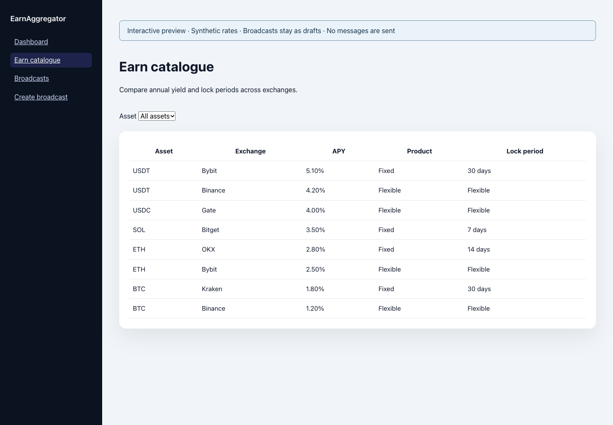
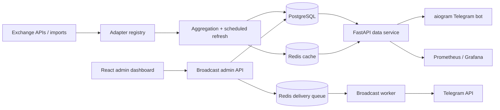

# EarnAggregator

**Cryptocurrency Earn discovery and Telegram broadcast operations.**

[](https://github.com/iow34/earnaggregator/actions/workflows/ci.yml)

EarnAggregator brings exchange Earn products into a common catalogue, serves them through a REST API and a multilingual Telegram bot, and gives administrators a separate dashboard for targeted broadcasts.

The system combines asynchronous Python services, PostgreSQL persistence, Redis caching and delivery queues, scheduled data refreshes, and a React administration interface.

## Capabilities

- **Exchange aggregation:** adapters for Binance, Bybit, OKX, BitMart, Bitget, Gate, HTX, Kraken, KuCoin and MEXC, with shared product models and a dynamic registry.
- **Discovery:** asset and exchange filters, flexible/fixed lock periods, APY comparison, trending assets and priority products.
- **Telegram interface:** English, Ukrainian and Russian content, pagination, language preferences and referral navigation.
- **Broadcast operations:** recipient filters, previews, owner approval, scheduling, delivery status, retries and event history.
- **Administration:** React/TypeScript dashboard, broadcast creation, lists and delivery summaries.
- **Observability:** request metrics, scheduler and queue metrics, structured logs, Prometheus and Grafana configuration.



## Explore the product

The interactive preview runs with synthetic rates and no credentials. It contains the catalogue and the administration interface. Broadcasts remain drafts and no messages are delivered. State resets when the preview server restarts.

```bash
git clone https://github.com/iow34/earnaggregator.git
cd earnaggregator
docker compose up --build --wait
```

Open [the interface](http://localhost:5173), choose **Earn catalogue**, and filter by asset. Then open **Create broadcast**, save a draft and inspect its detail page. The API is available at [localhost:8000/docs](http://localhost:8000/docs).

```bash
# Stop the preview
docker compose down
```

Prefer a local Python/Node setup? See [development](docs/development.md). Deployment of the connected services is covered in [deployment](docs/deployment.md).

## Architecture



The credential-free preview uses an isolated in-memory API. It does not import the connected services or start background exchange, scheduler or Telegram clients.

## Engineering details

| Area | Implementation |
| --- | --- |
| Backend | Python 3.11, FastAPI, Pydantic, SQLAlchemy, asyncpg |
| Bot | aiogram, localized content, stateful navigation |
| Storage | PostgreSQL; Redis cache and broadcast queue |
| Frontend | React, TypeScript, Vite, TanStack Query |
| Operations | Docker Compose, APScheduler, Prometheus/Grafana |
| Verification | Python regression tests, PostgreSQL schema/auth integration, frontend lint/build, dependency and secret scans in CI |

[Architecture and design decisions](docs/architecture.md) · [API and authorization](docs/api.md) · [Configuration](docs/configuration.md) · [Case study](docs/case-study.md)

## Repository layout

```text
yield-data-service/   Data API, adapters, models, aggregation and metrics
yield-telegram-bot/   Telegram UX, broadcast API, worker and localized content
broadcast-admin-web/ React administration interface
demo/                Isolated interactive preview
tests/               Current cross-service regression and integration checks
scripts/             Schema initialization and administrator provisioning
```

## Operational scope

This repository contains the completed implementation and its local preview. A hosted production instance is not currently maintained. Exchange endpoints, account entitlements and product availability change independently of this code; verify the relevant adapters and permissions before connecting an account. Historical import fixtures are snapshots, not live market rates. Displayed APY is informational and can change.

The frontend preview uses only synthetic data. Connected deployments require their own credentials, administrator provisioning, HTTPS and restricted network access. Read [security](SECURITY.md) before deployment.

## License and author

MIT — see [LICENSE](LICENSE). Developed by [iow34](https://github.com/iow34).
