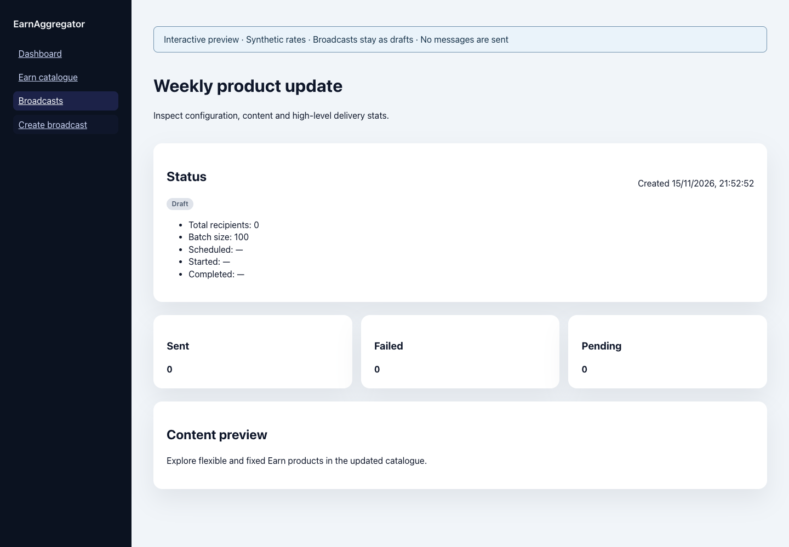

# EarnAggregator — product case study

## Problem

Exchange Earn products differ in response shape, asset naming, yield representation and lock periods. Comparing them manually requires switching between providers. Operators also need a way to communicate updates to Telegram audiences without managing messages one recipient at a time.

## Delivered system

I designed and implemented a platform that combines normalized Earn discovery with Telegram delivery and broadcast administration. The code covers adapter integrations, SQLAlchemy models and queries, Redis caching, background refresh jobs, multilingual bot navigation, campaign tracking, delivery workers and a React dashboard.

The repository includes a credential-free product preview so the catalogue and broadcast interface can be explored without connecting real accounts.

## Technical decisions

- **Adapter boundary:** provider-specific HTTP and authentication code stays separate from normalized products and API responses.
- **Separate services:** the data API, Telegram bot, admin API and worker have independent entrypoints and responsibilities.
- **Storage and cache:** PostgreSQL holds durable product and broadcast records; Redis handles cached reads and queued delivery work.
- **Broadcast state:** content, recipients, approval and delivery events are persisted rather than held only in a process.
- **Multilingual UI:** English, Ukrainian and Russian content is maintained independently of technical documentation.
- **Reproducibility:** locked dependencies, automated checks and an isolated preview support inspection from a clean checkout.

## What to inspect

| Skill | Code |
| --- | --- |
| External API integration | `yield-data-service/app/services/exchanges/` |
| Data modeling and querying | Both services' `db/` packages |
| Async service lifecycle and caching | `app/main.py`, `app/services/cache.py` |
| Background delivery | `bot/broadcasts/worker.py`, `scheduler.py`, `sender.py` |
| Telegram UX and localization | `bot/handlers/`, `bot/localization/`, `bot/content/` |
| Frontend integration | `broadcast-admin-web/src/` |
| Authorization and regression checks | `app/api/dependencies.py`, `bot/broadcasts/auth.py`, `tests/` |

## Results that can be inspected

The implementation provides a unified catalogue, multilingual Telegram flows and a separate broadcast administration workflow. The local preview demonstrates asset comparison, campaign drafting and detail inspection. CI runs the maintained tests, frontend build, dependency checks and container preview smoke checks.

No revenue, user-count, production throughput or uptime claim is made without measurements. The original hosted deployment is no longer active; provider integration compatibility should be verified before a new connected deployment.
